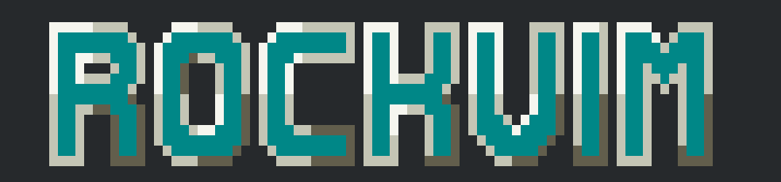

<p align="center">
  
</p>

<p align="center">
  A personal Neovim configuration built on <a href="https://github.com/LazyVim/LazyVim">LazyVim</a>.
</p>

<p align="center">
  
  
  
</p>

## Features

- **Monokai Soda** colorscheme (tokyonight and catppuccin disabled)
- **Custom dashboard** with the RockVim ANSI logo (`logo.txt`); `<leader>D` reopens it
- **Explorer** on the right side, not opened automatically on `nvim .`
- **blink.cmp** super-tab: Tab accepts, Enter always inserts a newline
- **No format on save**: format explicitly with `<leader>cf`
- **Indent** copies the previous line instead of using filetype indent rules
- **`gD`** falls back to go-to-definition when the LSP has no declaration support
- **Extras**: Claude Code, JSON, Markdown
- **Per-machine language modules** (PHP, TypeScript), see below

See [CHEATSHEET.md](CHEATSHEET.md) for keybindings.

## Requirements

- Neovim >= 0.11
- git, a C compiler (treesitter), ripgrep, fd
- A [Nerd Font](https://www.nerdfonts.com/)
- Node.js / PHP only if you enable the matching module

## Installation

Back up any existing config, then clone:

```sh
mv ~/.config/nvim{,.bak}
mv ~/.local/share/nvim{,.bak}
mv ~/.local/state/nvim{,.bak}
mv ~/.cache/nvim{,.bak}

git clone https://github.com/rockberpro/rockvim ~/.config/nvim
nvim
```

Plugins install on first launch.

## Language modules

Languages live in `lua/modules/<name>/` (extras + LSP config) and are enabled per machine.
Copy `lua/config/modules.example.lua` to `lua/config/modules.lua` (gitignored) and list the names:

```lua
return { "php", "typescript" }
```

| Module       | Includes                                                                                                   |
| ------------ | ---------------------------------------------------------------------------------------------------------- |
| `php`        | Intelephense (PHP version read from `composer.json`), phpcs, phpstan (only with a phpstan config), Blade   |
| `typescript` | vtsls, Vue, Tailwind, ESLint, Prettier                                                                     |

> **Notes**
> - `lazy-lock.json` only records plugins of enabled modules, so commit it from the full setup.
> - Enabling a language extra via `:LazyExtras` writes to `lazyvim.json` globally, bypassing modules.

## Keymaps

Custom keymaps on top of [LazyVim's defaults](https://www.lazyvim.org/keymaps):

| Key          | Action                           |
| ------------ | -------------------------------- |
| `<leader>D`  | Open dashboard                   |
| `<leader>xc` | Clear quickfix list              |
| `gD`         | Declaration (or definition)      |
| `<Tab>`      | Accept completion                |

## Structure

```
.
├── init.lua
├── logo.txt                 # dashboard logo (ANSI)
├── lua/
│   ├── config/              # options, keymaps, autocmds, lazy bootstrap, modules
│   ├── modules/             # per-language modules (php, typescript)
│   └── plugins/             # plugin specs and overrides
└── resources/img/           # README assets
```

## Credits

- [LazyVim](https://github.com/LazyVim/LazyVim) by folke
- Logo text generated with [TAAG](https://patorjk.com/software/taag/) (font: Boner)

## License

[Apache 2.0](LICENSE)
